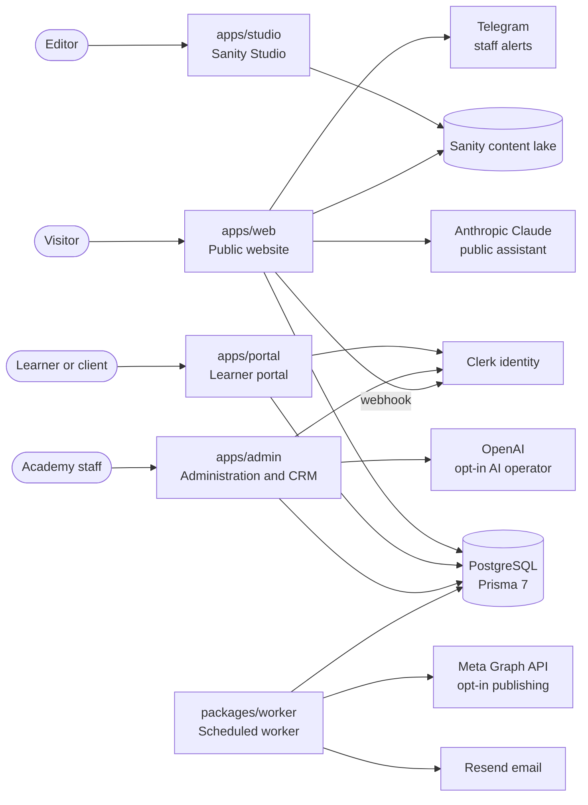

# Architecture

**English** · [العربية](ar/ARCHITECTURE.md)

This guide describes how the Luminol Academy platform is organised: the deployable applications, the shared packages they depend on, the external services they use, and how a request moves through the system. For environment variables and release steps, see [Configuration and deployment](CONFIGURATION.md).

## System overview

Each application is an independent Next.js project with its own Vercel deployment. Applications never import each other; everything they share lives in `packages/*` and is consumed through pnpm workspace dependencies.

## Applications

| Application   | Audience                       | Responsibilities                                                                                                                                                                      | Authentication                    |
| ------------- | ------------------------------ | ------------------------------------------------------------------------------------------------------------------------------------------------------------------------------------- | --------------------------------- |
| `apps/web`    | Public visitors                | Schools, programme catalogue, consultations, events and workshops, journal, contact, certificate verification, enquiry and newsletter capture, AI assistant                           | None (public), Clerk webhook only |
| `apps/portal` | Learners, clients, instructors | Courses, schedule, progress, certificates, finance, language placement, professional projects and reviews                                                                             | Clerk, protected by default       |
| `apps/admin`  | Academy staff                  | CRM (leads, contacts, deals, offers), consultations, clients, enrolments, cohorts, office payments, approvals, tasks, notifications, content calendar, social publishing, AI operator | Clerk plus database roles         |
| `apps/studio` | Editors                        | Programmes, site settings, team members and consent-confirmed testimonials                                                                                                            | Sanity accounts                   |

## Shared packages

| Package                  | Responsibility                                                                      |
| ------------------------ | ----------------------------------------------------------------------------------- |
| `@luminol/database`      | Prisma schema (78 models), migrations, generated client and data-access services    |
| `@luminol/auth`          | Role and permission model used by the portal and administration                     |
| `@luminol/validation`    | Zod schemas for environment, forms, enquiries, consultations, AI and content inputs |
| `@luminol/localization`  | Locale definitions, dictionaries, locale routing and right-to-left direction        |
| `@luminol/ui`            | Shared React primitives, including the Luminol wordmark                             |
| `@luminol/config`        | Tailwind tokens, ESLint and TypeScript presets, security headers                    |
| `@luminol/types`         | Cross-application domain types                                                      |
| `@luminol/utils`         | General helpers and security utilities                                              |
| `@luminol/language`      | Placement assessment, scoring and recommendations for the School of Languages       |
| `@luminol/professional`  | Competencies, cohorts, sessions, instructor ownership and corporate training        |
| `@luminol/finance`       | Currency handling, finance access rules, corporate billing and audit trail          |
| `@luminol/certificates`  | Certificate issuance and public verification                                        |
| `@luminol/notifications` | Notification model and Resend delivery                                              |
| `@luminol/emails`        | Transactional email templates                                                       |
| `@luminol/analytics`     | Conversion events and privacy-safe learning outcome metrics                         |
| `@luminol/worker`        | Run-once and continuous workers for notifications and scheduled social publishing   |

## Request lifecycle

### Locale routing

Every application serves Arabic (`ar`, right-to-left), French (`fr`) and English (`en`). A `proxy.ts` file at each application root resolves the locale before rendering:

1. A path with a locale prefix, such as `/ar/consultations`, is rewritten internally to `/consultations`. The resolved locale is passed to the page in a request header and stored in the `luminol_locale` cookie.
2. A path without a prefix is redirected to the visitor's stored locale, or to the default locale.
3. API routes, `robots.txt`, `sitemap.xml` and `.well-known` paths bypass locale routing.

The root layout sets `lang` and `dir` on the `<html>` element from the resolved locale, so right-to-left layout applies to the whole document.

### Public content

Programme, team and site content comes from Sanity. Published, active programmes are validated with Zod before rendering. When Sanity is not configured or a fetch fails, reviewed typed fallbacks keep the website online. Course enquiries verify the published programme without a cached response, so a retired programme returns `410` and an unverifiable one returns `503` instead of creating a generic lead.

### Enquiries and leads

1. A visitor submits a consultation, programme or contact enquiry. The form keeps the visitor's input until the request succeeds.
2. `POST /api/enquiries` validates the payload with Zod and, when configured, verifies a Cloudflare Turnstile token.
3. The lead is written to PostgreSQL and appears in the administration CRM.
4. Staff receive an optional Telegram alert, and email-first enquiries receive a Resend acknowledgement when email delivery is configured.

### Public AI assistant

`POST /api/assistant` answers questions about the academy with Anthropic Claude (default model `claude-haiku-5-5`). The visitor must give consent before chatting. Messages that suggest a crisis are answered with human contact details without calling the model. Requests are rate-limited per client, and without `ANTHROPIC_API_KEY` the assistant falls back to the academy's contact channels. The assistant's knowledge is built from the public site content only; it never reads CRM or client records.

### Authenticated applications

The portal and administration use Clerk middleware inside `proxy.ts`. Non-public routes call `auth.protect()`, and authorization decisions use database roles from `@luminol/auth`, never client-side state. A Clerk webhook keeps user records in PostgreSQL in sync.

### Administration AI operator

The administration AI operator drafts CRM proposals for staff review. It calls the OpenAI API only when `LUMINOL_AI_PROVIDER_MODE` is `OPENAI` and `OPENAI_API_KEY` is set, and it enforces a monthly budget and a request timeout. Staff approve every proposal before anything is executed.

### Background work

Scheduled GitHub Actions run the notification worker every 15 minutes and a production health check every 6 hours. Social publishing to Instagram is disabled by default and requires two explicit opt-in switches, plus a valid Meta access token.

## Security model

- Strict security headers and a Content Security Policy come from `@luminol/config/security-headers`.
- Secrets exist only in Vercel environment variables or GitHub Actions secrets, and never use the `NEXT_PUBLIC_` prefix.
- Every external input is validated with Zod at the boundary.
- CI scans tracked files for secrets, checks that GitHub Actions are pinned to commit SHAs, and audits production dependencies.
- Client and CRM data is never exposed to the public website or to the public assistant.

The Milestone 13 audit and launch runbook are recorded in [Security and launch readiness](SECURITY_AND_LAUNCH_READINESS.md).

## Testing strategy

| Layer               | Tool       | Scope                                                                                                 |
| ------------------- | ---------- | ----------------------------------------------------------------------------------------------------- |
| Unit                | Vitest     | Domain logic, validation, localization, routing, safety rules                                         |
| Integration         | Vitest     | Database services against an ephemeral PostgreSQL (`TEST_DATABASE_URL`)                               |
| Browser (public)    | Playwright | Navigation, localization and direction, enquiry flows, metadata, security headers, mobile readability |
| Browser (protected) | Playwright | Authenticated portal and administration journeys, when protected test state is configured             |

## Related documents

- [Configuration and deployment](CONFIGURATION.md)
- [Public website](PUBLIC_WEBSITE.md)
- [Design system](design-system.md) and [design rationale](DESIGN_RATIONALE.md)
- [CMS operations](cms.md)
- [Prisma 7 migration](PRISMA_7_MIGRATION.md)
