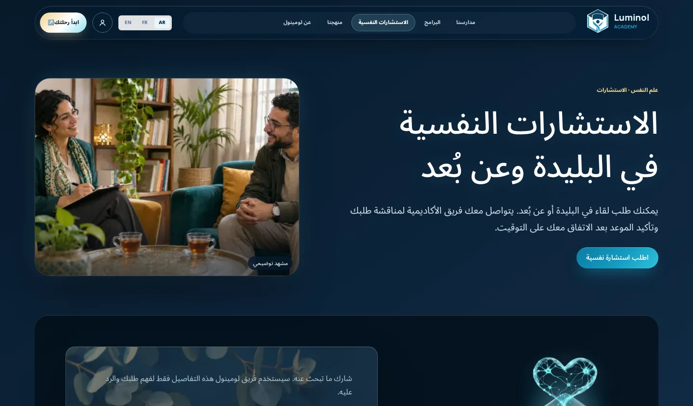
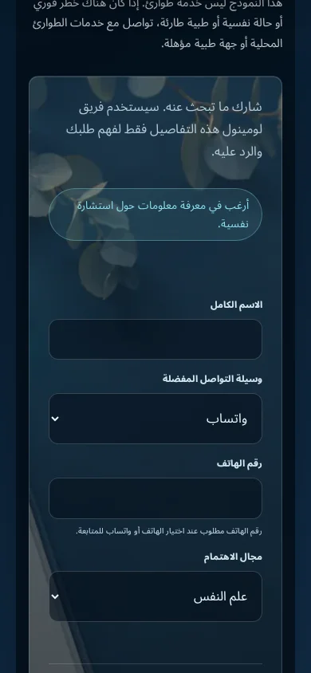
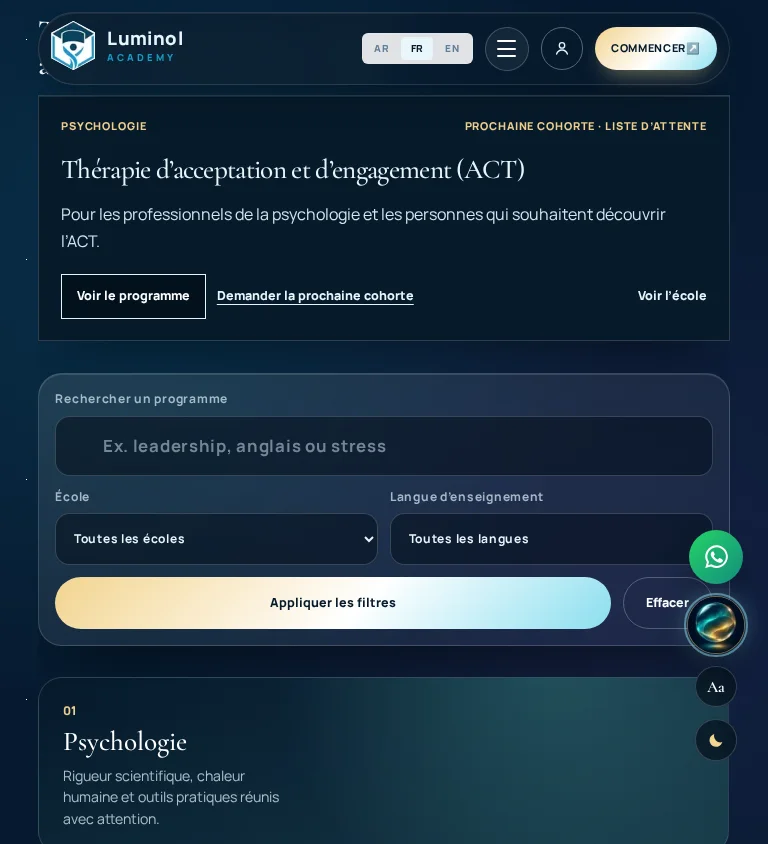
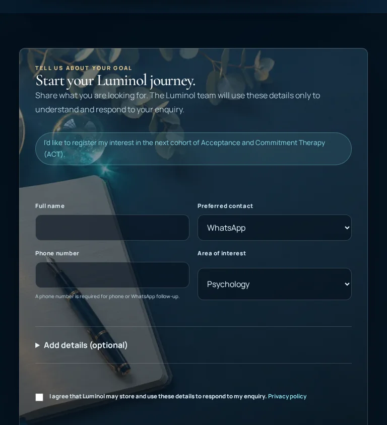
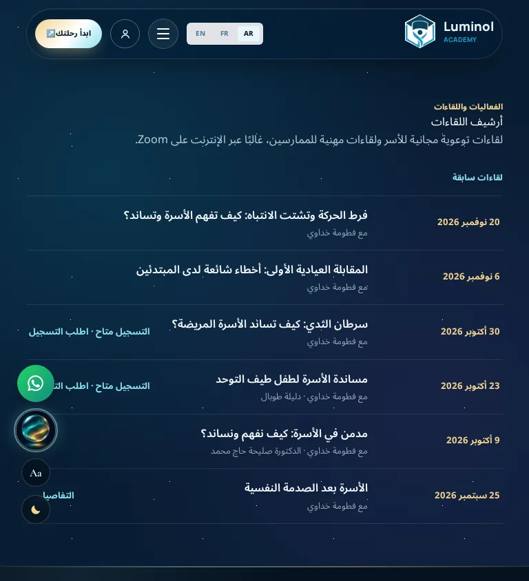

# Public site review: consultations and programmes

**English** · [العربية](ar/PUBLIC_SITE_REVIEW.md)

This page lets reviewers assess the public consultation and programme journeys directly on GitHub. The screenshots were captured in Chromium from the build of pull request #581 with a test programme catalogue. Select an image to view it at full size.

## Consultations

In Arabic, the text sits on the right and an illustrative photograph of a first meeting sits on the left. On phones, the introduction and the **اطلب استشارة نفسية** (request a psychological consultation) button appear before the photograph. The academy contacts the visitor and confirms the appointment once a time is agreed.

## Enquiry form

The first-screen button leads to the form. The visitor chooses WhatsApp, phone or email. While the visitor switches channel, the form keeps every contact entered until the request succeeds, and only the selected channel's contact is submitted. Optional fields open on request; consent is required. After an error, the visitor can correct a field or retry with the saved input.

## Catalogue, ACT programme and enquiry

The test catalogue publishes one ACT (Acceptance and Commitment Therapy) course, with its enrolment status next to the title. From the course page the visitor opens an enquiry for that programme. The programme name is shown in the form, and the school is taken from the programme's CMS record. If the CMS is temporarily unavailable, the visitor can retry. If the programme has been withdrawn, the form invites the visitor to choose another one.

## Past meetings archive

The home page links to all past meetings. The archive uses the end time in Algeria and the last day of multi-day events. Cards keep direct links to meeting pages when those pages are published.

## Reviewing the interactive version

A `localhost` address only works on the device that runs the site. To review the live build in a browser:

1. Create a GitHub Codespace on the branch under review, following the [Codespaces steps in the README](../README.md#github-codespaces).
2. Run the local setup commands and start the site.
3. Open **Ports → 3000 → Open in Browser** and append a path such as `/ar/consultations`, `/fr/programmes` or `/ar/events`.

Catalogue content depends on the connected Sanity dataset. The screenshots above are available without starting an environment.
