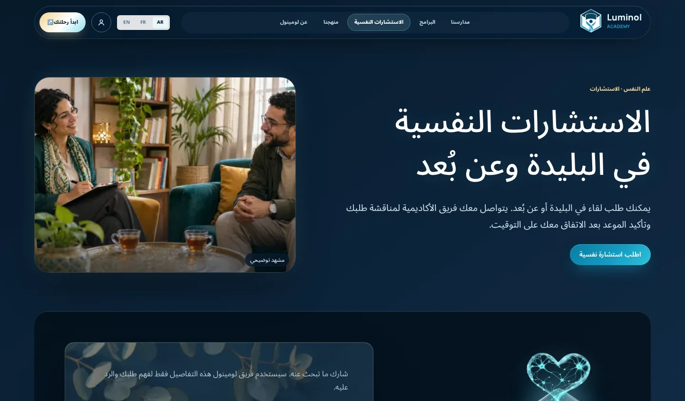
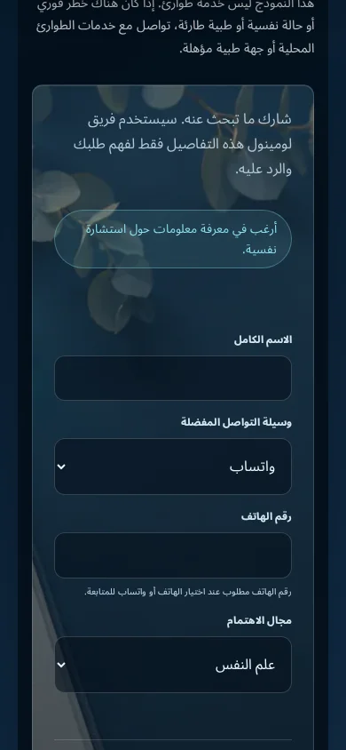
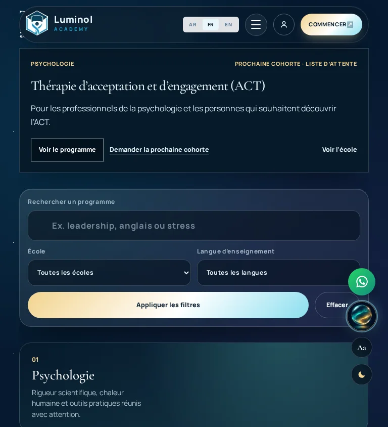
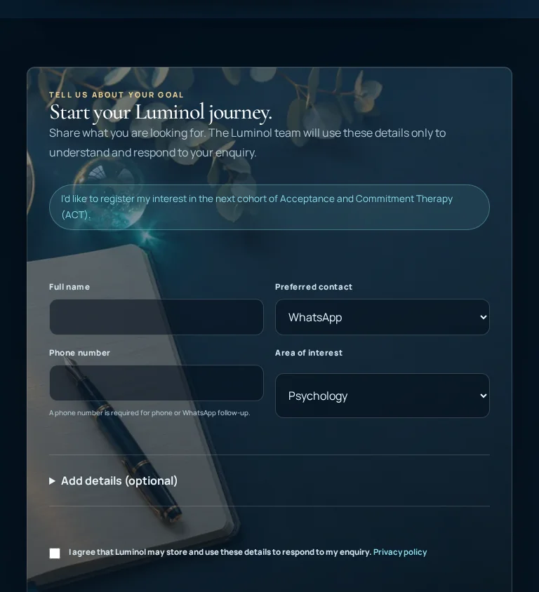
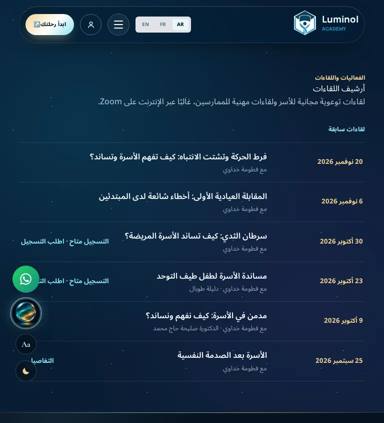

# Консультации и программы Luminol Academy

На этой странице можно посмотреть редизайн прямо в GitHub. Снимки сделаны в Chromium на сборке PR №581 с тестовым каталогом. Для просмотра в полном размере нажмите на изображение.

## Консультации

В арабской версии справа расположен текст, слева — иллюстративный кадр первой встречи. На телефоне предложение и кнопка «اطلب استشارة نفسية» идут перед фотографией. Команда академии связывается с посетителем и подтверждает запись после согласования времени.

## Форма обращения

Кнопка на первом экране ведёт к форме. Посетитель выбирает WhatsApp, телефон или email. При смене канала форма помнит введённые контакты до успешной отправки. В заявку попадает контакт выбранного канала. Дополнительные поля раскрываются по желанию, а согласие обязательно. При ошибке можно поправить поле или повторить отправку с сохранённым вводом.

## Каталог → ACT → обращение

В тестовом каталоге опубликован один курс ACT. Рядом с названием виден статус набора. Со страницы курса посетитель переходит к обращению по выбранной программе. Её название видно в форме, школа определяется по записи программы в CMS. Если CMS временно недоступна, посетитель может повторить отправку. Если программу сняли с публикации, форма предлагает выбрать другую.

## Архив встреч

С главной можно перейти ко всем прошедшим встречам. Архив учитывает время окончания в Алжире и последнюю дату многодневного события. Карточки сохраняют прямые ссылки на страницы встреч, если такие страницы опубликованы.

## Как открыть интерактивную версию

Адрес localhost открывает сервер на том устройстве, где запущен сайт. Для самостоятельной проверки в браузере откройте ветку `design/editorial-consultations` в своём GitHub Codespace. Выполните шаги настройки из [README](../README.md#browser-based-setup-github-codespaces), выбрав эту ветку при создании среды. Откройте **Ports → 3000 → Open in Browser** и добавьте к полученному адресу `/ar/consultations`, `/fr/programmes` или `/ar/events`. Содержимое каталога зависит от подключённого набора данных Sanity. Снимки выше доступны без запуска среды.
