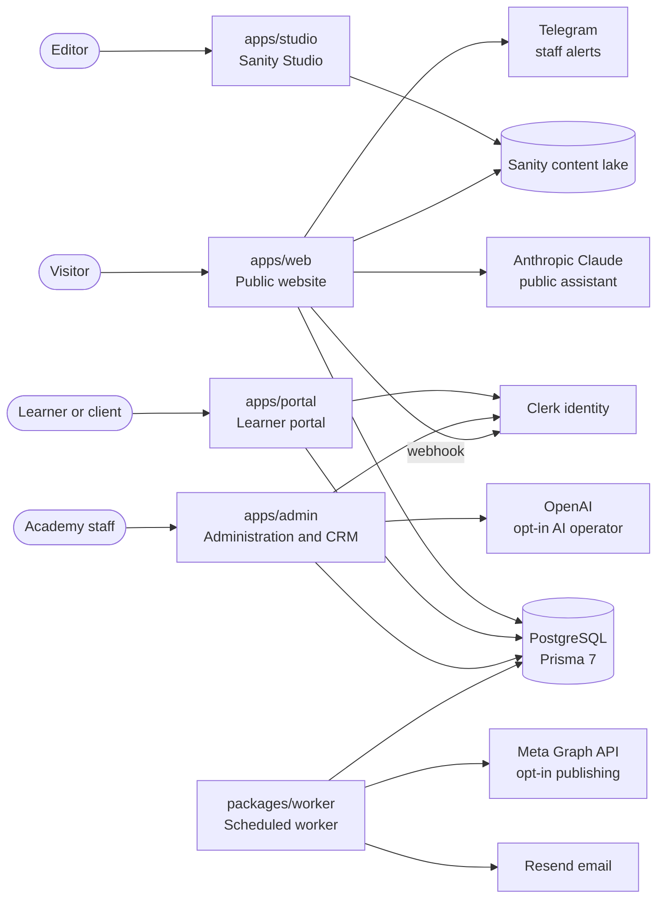

# البنية المعمارية

[English](../ARCHITECTURE.md) · **العربية**

يصف هذا الدليل تنظيم منصّة أكاديمية لومينول: التطبيقات القابلة للنشر، والحزم المشتركة التي تعتمد عليها، والخدمات الخارجية التي تستخدمها، ومسار الطلب داخل النظام. لمتغيّرات البيئة وخطوات الإصدار راجع [الإعداد والنشر](CONFIGURATION.md).

## نظرة عامة على النظام

كل تطبيق مشروع Next.js مستقل له نشره الخاص على Vercel. لا يستورد أي تطبيق تطبيقًا آخر؛ وكل ما هو مشترك موجود في `packages/*` ويُستهلك عبر اعتماديات مساحات عمل pnpm.

## التطبيقات

| التطبيق       | الجمهور                        | المسؤوليات                                                                                                                                                                                                                                        | المصادقة                                |
| ------------- | ------------------------------ | ------------------------------------------------------------------------------------------------------------------------------------------------------------------------------------------------------------------------------------------------- | --------------------------------------- |
| `apps/web`    | زوّار الموقع                   | المدارس، وفهرس البرامج، والاستشارات، والفعاليات وورشات العمل، والمجلّة، والتواصل، والتحقق من الشهادات، واستقبال الطلبات والاشتراك في النشرة، والمساعد الذكي                                                                                       | لا توجد (عام)، مع خطاف Clerk فقط        |
| `apps/portal` | المتعلّمون والعملاء والمدرّبون | الدورات، والجدول، والتقدّم، والشهادات، والمالية، وتحديد مستوى اللغة، والمشاريع المهنية ومراجعتها                                                                                                                                                  | Clerk، والمسارات محمية افتراضيًا        |
| `apps/admin`  | فريق الأكاديمية                | إدارة علاقات العملاء (العملاء المحتملون، وجهات الاتصال، والصفقات، والعروض)، والاستشارات، والعملاء، والتسجيلات، والأفواج، ومدفوعات المكتب، والموافقات، والمهام، والإشعارات، وتقويم المحتوى، والنشر على الشبكات الاجتماعية، ومشغّل الذكاء الاصطناعي | Clerk مع أدوار مخزّنة في قاعدة البيانات |
| `apps/studio` | المحرّرون                      | البرامج، وإعدادات الموقع، وأعضاء الفريق، والشهادات المؤكَّدة بموافقة أصحابها                                                                                                                                                                      | حسابات Sanity                           |

## الحزم المشتركة

| الحزمة                   | المسؤولية                                                                          |
| ------------------------ | ---------------------------------------------------------------------------------- |
| `@luminol/database`      | مخطط Prisma (78 نموذجًا)، والترحيلات، والعميل المولَّد، وخدمات الوصول إلى البيانات |
| `@luminol/auth`          | نموذج الأدوار والصلاحيات المستخدم في البوابة والإدارة                              |
| `@luminol/validation`    | مخططات Zod للبيئة والنماذج والطلبات والاستشارات والذكاء الاصطناعي والمحتوى         |
| `@luminol/localization`  | تعريف اللغات، والقواميس، وتوجيه اللغة، واتجاه الكتابة من اليمين إلى اليسار         |
| `@luminol/ui`            | مكوّنات React المشتركة، ومنها شعار لومينول                                         |
| `@luminol/config`        | رموز Tailwind، وإعدادات ESLint وTypeScript، وترويسات الأمان                        |
| `@luminol/types`         | أنواع النطاق المشتركة بين التطبيقات                                                |
| `@luminol/utils`         | أدوات عامة وأدوات أمان                                                             |
| `@luminol/language`      | اختبار تحديد المستوى والتقييم والتوصيات لمدرسة اللغات                              |
| `@luminol/professional`  | الكفاءات، والأفواج، والجلسات، وملكية المدرّبين، والتدريب المؤسسي                   |
| `@luminol/finance`       | العملات، وقواعد الوصول المالي، وفوترة المؤسسات، وسجلّ التدقيق                      |
| `@luminol/certificates`  | إصدار الشهادات والتحقق العلني منها                                                 |
| `@luminol/notifications` | نموذج الإشعارات والإرسال عبر Resend                                                |
| `@luminol/emails`        | قوالب البريد الإلكتروني للمعاملات                                                  |
| `@luminol/analytics`     | أحداث التحويل ومؤشّرات نتائج التعلّم التي تحفظ الخصوصية                            |
| `@luminol/worker`        | عمّال لمرة واحدة ومستمرّون للإشعارات والنشر الاجتماعي المجدول                      |

## دورة حياة الطلب

### توجيه اللغة

يخدم كل تطبيق العربية (`ar`، من اليمين إلى اليسار) والفرنسية (`fr`) والإنجليزية (`en`). يحدّد الملف `proxy.ts` في جذر كل تطبيق اللغة قبل العرض:

1. يُعاد كتابة المسار الذي يبدأ ببادئة لغة، مثل `/ar/consultations`، داخليًا إلى `/consultations`. تُمرَّر اللغة المحدّدة إلى الصفحة في ترويسة الطلب وتُحفظ في ملف تعريف الارتباط `luminol_locale`.
2. يُعاد توجيه المسار الذي لا يحمل بادئة إلى لغة الزائر المحفوظة أو إلى اللغة الافتراضية.
3. مسارات الواجهات البرمجية و`robots.txt` و`sitemap.xml` ومسارات `.well-known` لا تمرّ بتوجيه اللغة.

يضبط التخطيط الجذري الخاصيتين `lang` و`dir` على العنصر `<html>` وفق اللغة المحدّدة، فيُطبَّق الاتجاه من اليمين إلى اليسار على المستند كله.

### المحتوى العام

يأتي محتوى البرامج والفريق والموقع من Sanity. يُتحقَّق من البرامج المنشورة والنشطة عبر Zod قبل عرضها. وعند غياب إعداد Sanity أو فشل الجلب، تُبقي البدائل المكتوبة والمراجَعة الموقعَ متاحًا. تتحقّق طلبات الدورات من البرنامج المنشور دون استجابة مخزّنة مؤقتًا، فيُعيد البرنامج المسحوب الرمز `410` ويُعيد البرنامج الذي يتعذّر التحقق منه الرمز `503` بدل إنشاء طلب عام.

### الطلبات والعملاء المحتملون

1. يرسل الزائر طلب استشارة أو برنامج أو تواصل، ويحتفظ النموذج بمدخلاته حتى ينجح الطلب.
2. يتحقّق `POST /api/enquiries` من البيانات عبر Zod، ومن رمز Cloudflare Turnstile عند إعداده.
3. يُحفظ الطلب في PostgreSQL ويظهر في نظام إدارة علاقات العملاء.
4. يتلقّى الفريق تنبيهًا اختياريًا عبر Telegram، ويتلقّى أصحاب الطلبات المرسلة بالبريد إقرارًا عبر Resend عند إعداد البريد.

### المساعد الذكي العام

يجيب `POST /api/assistant` عن الأسئلة المتعلقة بالأكاديمية باستخدام Anthropic Claude (النموذج الافتراضي `claude-haiku-5-5`). يجب أن يوافق الزائر قبل بدء المحادثة. تُقابَل الرسائل التي توحي بأزمة ببيانات التواصل البشري دون استدعاء النموذج. تخضع الطلبات لحدّ لكل عميل، وعند غياب `ANTHROPIC_API_KEY` يعرض المساعد قنوات تواصل الأكاديمية. تُبنى معرفة المساعد من محتوى الموقع العام وحده، ولا يقرأ سجلّات العملاء أو نظام إدارة علاقات العملاء أبدًا.

### مشغّل الذكاء الاصطناعي في الإدارة

يصوغ مشغّل الذكاء الاصطناعي في الإدارة مقترحات لنظام إدارة علاقات العملاء ليراجعها الفريق. لا يستدعي واجهة OpenAI إلا عندما تكون قيمة `LUMINOL_AI_PROVIDER_MODE` هي `OPENAI` ويكون `OPENAI_API_KEY` مضبوطًا، ويطبّق ميزانية شهرية ومهلة للطلبات. يوافق الفريق على كل مقترح قبل تنفيذ أي شيء.

### التطبيقات الموثّقة

تستخدم البوابة والإدارة وسيط Clerk داخل `proxy.ts`. تستدعي المسارات غير العامة `auth.protect()`، وتعتمد قرارات الصلاحيات على أدوار قاعدة البيانات عبر `@luminol/auth`، لا على حالة المتصفح أبدًا. ويُبقي خطاف Clerk سجلّات المستخدمين في PostgreSQL متزامنة.

### الأعمال في الخلفية

تُشغّل GitHub Actions المجدولة عامل الإشعارات كل 15 دقيقة وفحصًا لسلامة الإنتاج كل 6 ساعات. النشر على Instagram معطّل افتراضيًا ويتطلّب مفتاحَي تفعيل صريحين ورمز وصول صالحًا من Meta.

## نموذج الأمان

- تأتي ترويسات الأمان الصارمة وسياسة أمان المحتوى (CSP) من `@luminol/config/security-headers`.
- لا توجد الأسرار إلا في متغيّرات بيئة Vercel أو أسرار GitHub Actions، ولا تحمل أبدًا البادئة `NEXT_PUBLIC_`.
- يُتحقَّق من كل مدخل خارجي عبر Zod عند الحدود.
- يفحص التكامل المستمر الملفات المتتبَّعة بحثًا عن أسرار، ويتأكّد من تثبيت GitHub Actions على بصمات الإيداعات، ويدقّق اعتماديات الإنتاج.
- لا تُكشف بيانات العملاء ونظام إدارة علاقات العملاء للموقع العام ولا للمساعد العام.

## استراتيجية الاختبار

| الطبقة         | الأداة     | النطاق                                                                                                            |
| -------------- | ---------- | ----------------------------------------------------------------------------------------------------------------- |
| الوحدات        | Vitest     | منطق النطاق، والتحقق، والتوطين، والتوجيه، وقواعد السلامة                                                          |
| التكامل        | Vitest     | خدمات قاعدة البيانات على PostgreSQL مؤقت (`TEST_DATABASE_URL`)                                                    |
| المتصفح (عام)  | Playwright | التنقّل، والتوطين واتجاه الكتابة، ومسارات الطلبات، والبيانات الوصفية، وترويسات الأمان، وقابلية القراءة على الهاتف |
| المتصفح (محمي) | Playwright | مسارات البوابة والإدارة الموثّقة عند توفّر حالة الاختبار المحمية                                                  |

## وثائق ذات صلة

- [الإعداد والنشر](CONFIGURATION.md)
- [الموقع العام](PUBLIC_WEBSITE.md)
- [نظام التصميم](../design-system.md) و[مبرّرات التصميم](../DESIGN_RATIONALE.md) (بالإنجليزية)
- [عمليات إدارة المحتوى](../cms.md) (بالإنجليزية)

