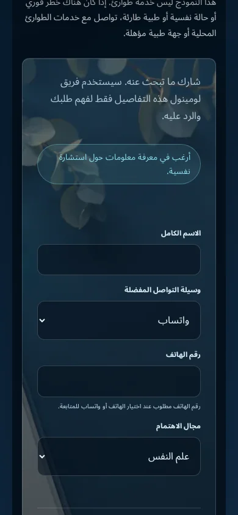
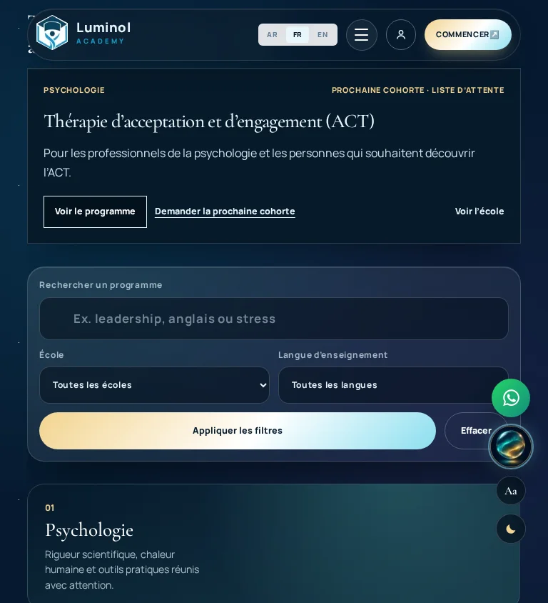
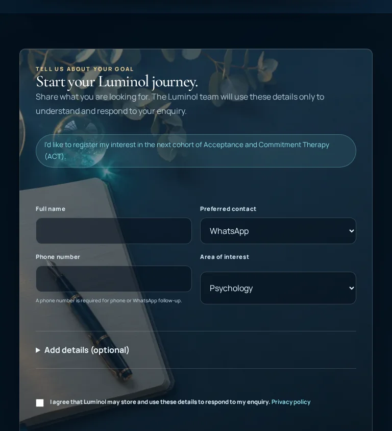
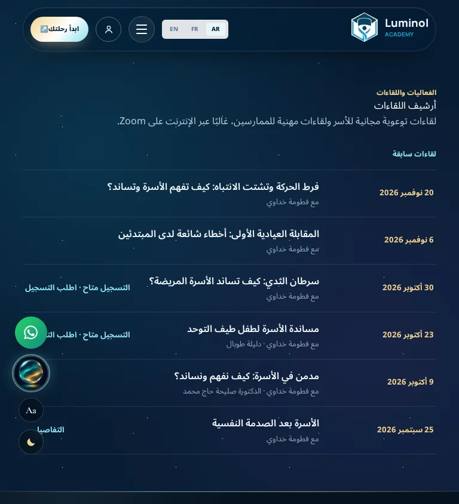

# مراجعة الموقع العام: الاستشارات والبرامج

[English](../PUBLIC_SITE_REVIEW.md) · **العربية**

تتيح هذه الصفحة للمراجعين تقييم مسارَي الاستشارات والبرامج في الموقع العام مباشرةً على GitHub. التُقطت الصور في متصفح Chromium من نسخة طلب الدمج ‎#581‎ مع فهرس برامج اختباري. انقر على أي صورة لعرضها بحجمها الكامل.

## الاستشارات

في النسخة العربية يقع النص على اليمين، وتقع على اليسار صورة توضيحية لأول لقاء. على الهاتف، تظهر المقدّمة وزرّ **اطلب استشارة نفسية** قبل الصورة. يتواصل فريق الأكاديمية مع الزائر ويؤكّد الموعد بعد الاتفاق على الوقت.

## نموذج الطلب

يقود زرّ الشاشة الأولى إلى النموذج. يختار الزائر واتساب أو الهاتف أو البريد الإلكتروني. وأثناء تبديل القناة، يحتفظ النموذج بكل بيانات التواصل المُدخلة حتى ينجح الإرسال، ولا يُرسَل إلا تواصل القناة المختارة. تُفتح الحقول الإضافية عند الطلب، والموافقة إلزامية. وعند حدوث خطأ، يمكن للزائر تصحيح الحقل أو إعادة الإرسال بالمدخلات المحفوظة.

## الفهرس وبرنامج ACT والطلب

ينشر الفهرس الاختباري دورة واحدة في العلاج بالقبول والالتزام (ACT)، وتظهر حالة التسجيل بجانب العنوان. ومن صفحة الدورة ينتقل الزائر إلى طلب خاص بهذا البرنامج. يظهر اسم البرنامج في النموذج، وتُحدَّد المدرسة من سجلّ البرنامج في نظام إدارة المحتوى. إذا كان نظام إدارة المحتوى غير متاح مؤقتًا، يمكن للزائر إعادة المحاولة. وإذا سُحب البرنامج من النشر، يدعو النموذج الزائر إلى اختيار برنامج آخر.

## أرشيف اللقاءات

تتيح الصفحة الرئيسية الانتقال إلى جميع اللقاءات السابقة. يعتمد الأرشيف على وقت الانتهاء بتوقيت الجزائر وعلى اليوم الأخير للفعاليات الممتدّة على عدّة أيام. وتحتفظ البطاقات بروابط مباشرة إلى صفحات اللقاءات عند نشرها.

## مراجعة النسخة التفاعلية

لا يعمل عنوان `localhost` إلا على الجهاز الذي يشغّل الموقع. لمراجعة النسخة الحيّة في المتصفح:

1. أنشئ GitHub Codespace على الفرع قيد المراجعة باتباع [خطوات Codespaces في الملف التعريفي](../../README.ar.md#github-codespaces).
2. نفّذ أوامر الإعداد المحلي وشغّل الموقع.
3. افتح **Ports ← 3000 ← Open in Browser** وأضف إلى العنوان مسارًا مثل `/ar/consultations` أو `/fr/programmes` أو `/ar/events`.

يعتمد محتوى الفهرس على مجموعة بيانات Sanity المتصلة. أما الصور أعلاه فمتاحة دون تشغيل أي بيئة.

